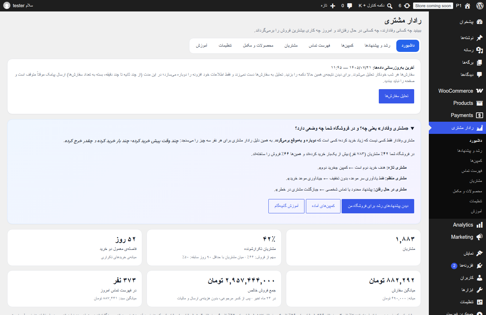
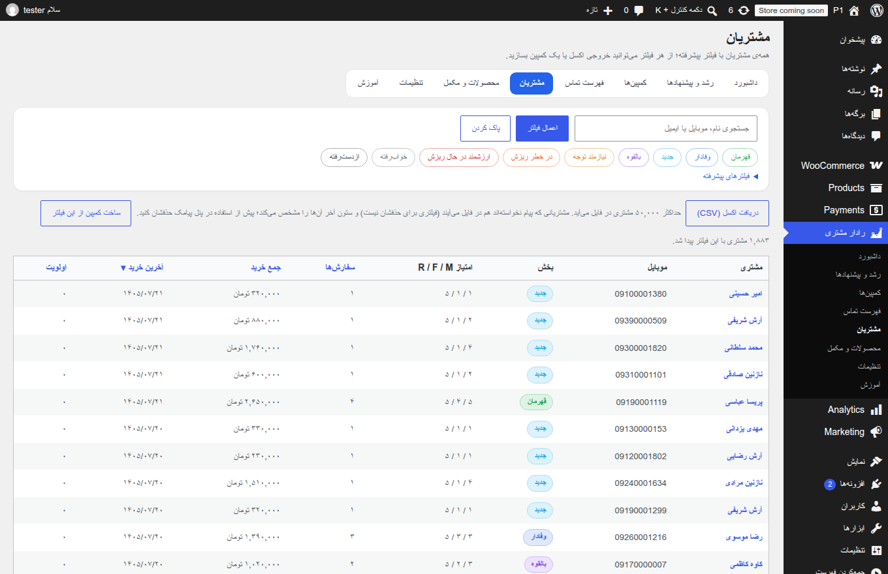
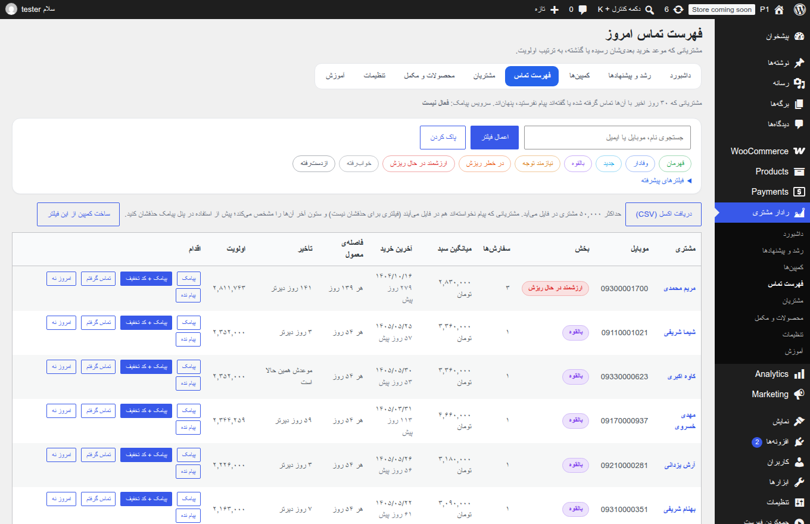
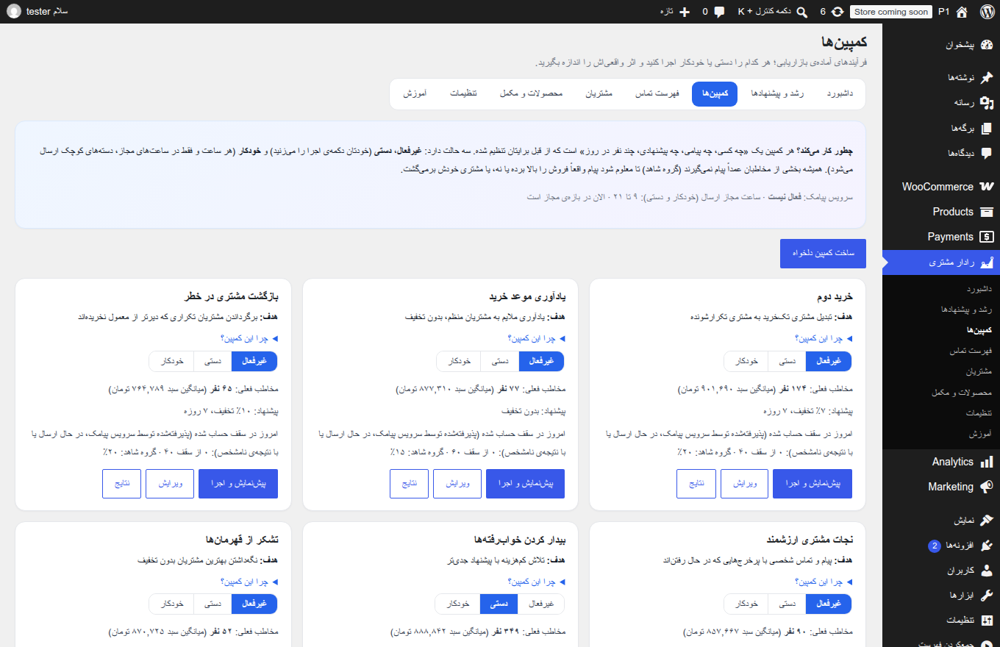
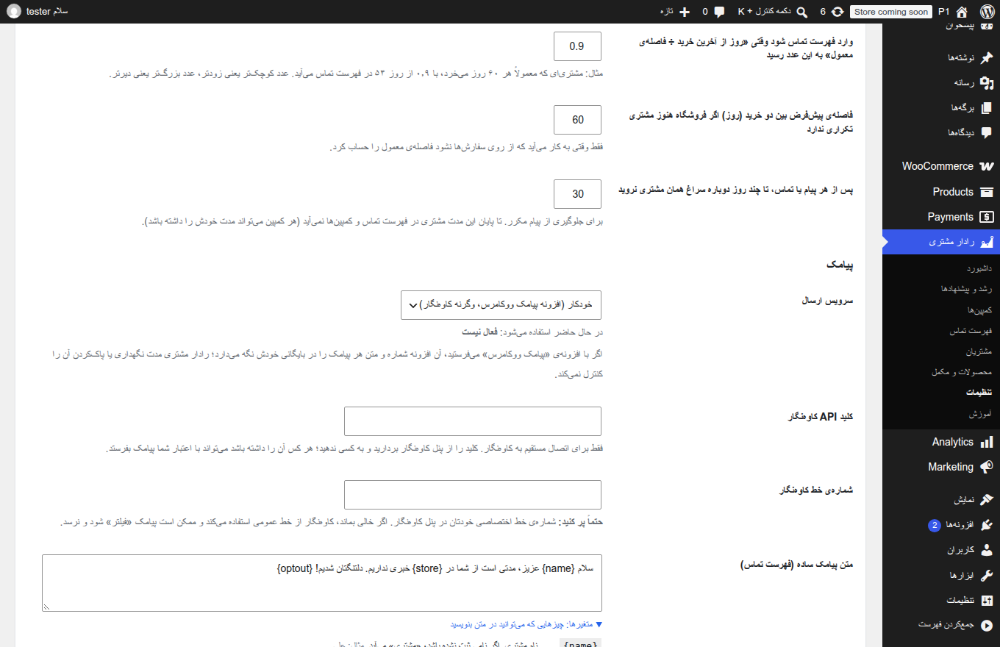

# راهنمای استفاده از «رادار مشتری»

نسخه‌ی ۱٫۰٫۲ — برای مدیر فروشگاه ووکامرس. این راهنما همان محتوای تب «آموزش» داخل افزونه است، با نصب و به‌روزرسانی. تصویرها از یک فروشگاه آزمایشی با داده‌ی ساختگی گرفته شده‌اند (هیچ مشتری واقعی در آن‌ها نیست).

## ۱. رادار مشتری چه می‌کند؟
هر شب سفارش‌های فروشگاه را می‌خواند، مشتریان را به ۹ گروه تقسیم می‌کند و می‌گوید **امروز با چه کسانی تماس بگیرید**. در صورت تمایل از داخل همان افزونه برای آن‌ها پیامک (با یا بدون کد تخفیف اختصاصی) می‌فرستد.
افزونه هیچ پیامکی را بدون تصمیم شما نمی‌فرستد: کمپین‌ها به‌طور پیش‌فرض **غیرفعال** هستند.

## ۲. نصب، به‌روزرسانی و اولین راه‌اندازی
**نیازمندی‌ها:** وردپرس ۶٫۰ به بالا، PHP ۷٫۴ به بالا، ووکامرس ۷٫۰ به بالا.

**به‌روزرسانی:** پیش از هر کاری از پایگاه‌داده پشتیبان بگیرید (فهرست «پیام نده» فقط در آن است). بعد در «افزونه‌ها ← افزودن ← بارگذاری افزونه» ZIP جدید را بارگذاری کنید و گزینه‌ی جایگزینی را بزنید. اگر از نسخه‌ی ۱٫۰٫۰ می‌آیید، یک‌بار «تحلیل سفارش‌ها» را بزنید؛ تا آن موقع ارسال پیامک متوقف است. نسخه‌ی ۱٫۰٫۲ نسبت به ۱٫۰٫۱ فقط واسط را آموزنده‌تر کرده است.

**نصب:**
1. «افزونه‌ها ← افزودن ← بارگذاری افزونه»، فایل ZIP را انتخاب و فعال کنید (ووکامرس باید فعال باشد).
2. از منوی «رادار مشتری» روی **«تحلیل سفارش‌ها»** بزنید و صبر کنید تا پیام «انجام شد» بیاید. (از این پس هر شب ساعت ۳ بامداد خودکار انجام می‌شود.)
3. در «تنظیمات» سرویس پیامک را انتخاب کنید (بخش ۷).

## ۳. داشبورد
* **مشتریان / مشتریان تکرارشونده / فاصله‌ی معمول دو خرید / میانگین سفارش / جمع فروش خالص / فهرست تماس امروز**: عددهای اصلی فروشگاه.
* «فروش» در این افزونه یعنی **فروش خالص**: مبلغ اقلام کالا منهای مرجوعی، بدون هزینه‌ی ارسال، مالیات و هزینه‌های جانبی (مثل «پرداخت در محل»).
* نمودارها: فروش ماهانه (مشتری جدید یا قدیمی)، سهم هر گروه، فاصله‌ی بین دو خرید، احتمال بازگشت، تمرکز فروش و نگهداشت ماهانه.

## ۴. گروه‌های مشتریان
قهرمان، وفادار، جدید، بالقوه، نیازمند توجه، در خطر ریزش، ارزشمند در حال ریزش، خواب‌رفته، ازدست‌رفته. گروه هر مشتری از سه چیز می‌آید: **چند وقت پیش خرید کرده، چند بار خرید کرده، چقدر خرج کرده** (RFM). در صفحه‌ی «مشتریان» می‌توانید بر اساس گروه، تعداد سفارش، مبلغ، محصول و… فیلتر کنید.

## ۵. فهرست تماس امروز
مشتریانی که طبق الگوی خرید خودشان **موعد خرید بعدی‌شان رسیده یا گذشته**، به ترتیب اولویت. «اولویت» یک فرمول ساده است (میانگین سبد × ضریب زمان‌بندی × وزن گروه) و پیش‌بینی آماری نیست. برای هر مشتری:
* **پیامک** یا **پیامک + کد تخفیف**: پیش از ارسال متن و شماره را به شما نشان می‌دهد و تأیید می‌خواهد.
* **تماس گرفتم** / **امروز نه**: تا چند روز در فهرست نمی‌آید.
* **پیام نده**: از این پس هیچ پیامکی برای این مشتری ارسال نمی‌شود (بخش ۹).

## ۶. کمپین‌ها
کمپین یعنی «به چه کسانی، چه پیامی، با چه پیشنهادی».
* **حالت**: «غیرفعال» (هیچ ارسالی)، «دستی» (فقط وقتی شما «پیش‌نمایش و اجرا» را بزنید)، «خودکار» (هر ساعت، فقط در ساعت مجاز).
* **پیش‌نمایش**: تعداد مخاطب، نمونه پیام‌ها و «سناریوی فروش اضافه» (یک سناریوی فرضی، نه پیش‌بینی) را نشان می‌دهد.
* **گروه شاهد**: درصدی از مخاطبان عمداً پیام نمی‌گیرند تا اثر واقعی کمپین سنجیده شود. نتیجه‌ی کمپین را در «نتایج» ببینید؛ مقایسه‌ی اصلی «انتخاب‌شده برای پیام» با «گروه شاهد» است.
* **سقف روزانه** و **ساعت مجاز ارسال** (پیش‌فرض ۹ تا ۲۱، از «تنظیمات»): فقط مدیر سایت می‌تواند خارج از ساعت مجاز ارسال کند و این کار با نام او ثبت می‌شود.
* مشتری‌ای که به تازگی تماس گرفته شده یا «پیام نده» شده، در هیچ کمپینی نمی‌آید.

## ۷. تنظیم سرویس پیامک
* **افزونه‌ی «پیامک ووکامرس»** (اگر نصب باشد خودکار استفاده می‌شود)، یا
* **کاوه‌نگار مستقیم**: کلید API و (توصیه‌شده) شماره‌ی خط اختصاصی خودتان را وارد کنید. بدون خط اختصاصی ممکن است پیامک «فیلتر» شود.
* متن هر پیامک تبلیغاتی باید `{optout}` (پیش‌فرض «لغو۱۱») داشته باشد؛ افزونه بدون آن ارسال نمی‌کند.

**«پذیرفته‌شده» یعنی چه؟** یعنی سرویس پیامک درخواست را پذیرفت. افزونه رسید تحویل ندارد و نمی‌تواند بگوید پیامک به گوشی رسیده. وضعیت واقعی را در پنل سرویس پیامک ببینید.

**«نتیجه نامشخص» یعنی چه؟** پاسخ سرویس پیامک نرسید یا مبهم بود (مثلاً قطع ارتباط). ممکن است پیامک رفته باشد، پس افزونه عمداً **دوباره نمی‌فرستد** تا پیام تکراری نرود. وضعیت را در پنل سرویس پیامک بررسی کنید.

## ۷-ب. تب «آموزش» و توضیح‌های کنار تنظیمات
در خود افزونه یک تب «آموزش» هست با شروع سریع، RFM، محصولات مکمل، نوشتن متن پیامک، کمپین‌ها، تحلیل سفارش‌ها، پشتیبان‌گیری و حریم خصوصی. کنار هر تنظیم هم توضیح و مثال نوشته شده، و زیر هر متن پیامک فهرست متغیرها و معنی هر کدام هست. پیش از کارهای مهم (خودکار کردن کمپین، «پیام نده»، ساخت کد تخفیف بسته) پیامد کار پرسیده می‌شود.

## ۸. اگر چیزی ارسال نشد
صفحه‌ی کمپین علت را می‌نویسد. موارد رایج: سرویس پیامک تنظیم نشده؛ خارج از ساعت مجاز؛ به سقف امروز رسیده‌اید؛ اعتبار پنل پیامک تمام شده؛ شماره‌ی مشتری از طرف سرویس رد شده؛ حساب کاوه‌نگار در حالت آزمایشی است (کد ۵۰۱: فقط به شماره‌ی صاحب حساب می‌فرستد).

## ۹. لغو عضویت («پیام نده»)
* دکمه‌ی «پیام نده» در فهرست تماس یا صفحه‌ی مشتری، مشتری را برای همیشه از پیامک کنار می‌گذارد (برای همه‌ی شماره/ایمیل‌هایی که افزونه او را با آن‌ها یکی می‌داند).
* افزونه پاسخ‌های مشتریان (مثلاً «لغو۱۱») را **دریافت نمی‌کند**؛ اجرای آن با سرویس پیامک/اپراتور شماست. اگر سرویس‌تان لغوی را اعلام کرد، آن را خودتان با «پیام نده» ثبت کنید.
* با حذف افزونه، فهرست «پیام نده» (فقط شناسه و زمان) می‌ماند؛ برای پاک‌شدن کامل، پیش از حذف در «تنظیمات» گزینه‌ی «با حذف افزونه، همه‌چیز پاک شود» را تیک بزنید و ذخیره کنید.

## ۱۰. حریم خصوصی، پشتیبان و خروجی اکسل (مهم)
* اگر با **«پیامک ووکامرس»** می‌فرستید، آن افزونه شماره و متن هر پیامک را در بایگانی خودش نگه می‌دارد؛ رادار مشتری مدت نگهداری آن را کنترل نمی‌کند و پاک‌کردن اطلاعات یک مشتری در رادار مشتری آن را پاک نمی‌کند.
* ردیف سابقه‌ی مشتریانی که دیگر در سفارش‌ها نیستند، حتی بعد از پاک‌شدن متنش، ممکن است شماره‌ی موبایل را نگه دارد.
* **بازگردانی پشتیبان:** اگر پشتیبان قدیمی‌تری از پایگاه‌داده را بازگردانید، کسانی که بعد از آن تاریخ «پیام نده» شده‌اند از دست می‌روند. افزونه نمی‌تواند این را بفهمد. پیش از بازگردانی خروجی اکسل مشتریان را بگیرید (ستون آخر «پیام نده»‌ها را نشان می‌دهد)، بعد از آن دوباره ثبتشان کنید، کمپین‌های خودکار را تا آن موقع خاموش نگه دارید و «تحلیل سفارش‌ها» را بزنید.
* **خروجی اکسل:** حداکثر ۵۰٬۰۰۰ مشتری؛ «پیام نده»‌ها هم در فایل می‌آیند (ستون آخر علامت می‌زند) و فیلتری برای حذفشان نیست؛ پیش از استفاده در پنل پیامک ردیف‌های علامت‌خورده را حذف کنید.
* در «تنظیمات ← حریم خصوصی» وردپرس متن پیشنهادی افزونه برای سیاست حریم خصوصی هست؛ آن را بازبینی کنید (متن حقوقی نیست).

## ۱۱. سایت آزمایشی و انتقال سایت
اگر از پایگاه‌داده‌ی سایت واقعی یک نسخه‌ی کپی (آزمایشی، لوکال) ساختید، افزونه تشخیص می‌دهد نشانی عوض شده: کمپین‌های **خودکار** متوقف می‌شوند و یک هشدار می‌بینید. ارسال دستی فقط برای «مدیر سایت» و فقط پس از تأیید هشدار در پیش‌نمایش ممکن است. اگر سایت واقعاً به نشانی جدید منتقل شده، مدیر سایت دکمه‌ی «تأیید: این سایت اصلی است» را می‌زند. **در سایت آزمایشی کلید API پیامک را عوض یا خالی کنید**؛ کلید واقعی هم کپی شده است.

## ۱۲. پرسش‌های متداول
* **چه سفارش‌هایی شمرده می‌شود؟** پیش‌فرض «تکمیل‌شده» و «در حال انجام»؛ از «تنظیمات» قابل تغییر است.
* **به‌روزرسانی داده‌ها چقدر طول می‌کشد؟** نمونه‌ی آزمایشی ما با ۳٬۲۵۸ سفارش: چند ثانیه تا چند دقیقه، بسته به هاست.
* **پس از به‌روزرسانی از نسخه‌ی ۱٫۰٫۰ چه کنم؟** یک بار «تحلیل سفارش‌ها» را بزنید؛ تا آن موقع ارسال پیامک متوقف است.
* **چندسایتی (Multisite)؟** پشتیبانی و آزمایش نشده است.
* **پشتیبانی:** از طریق صفحه‌ی محصول در بازار.
